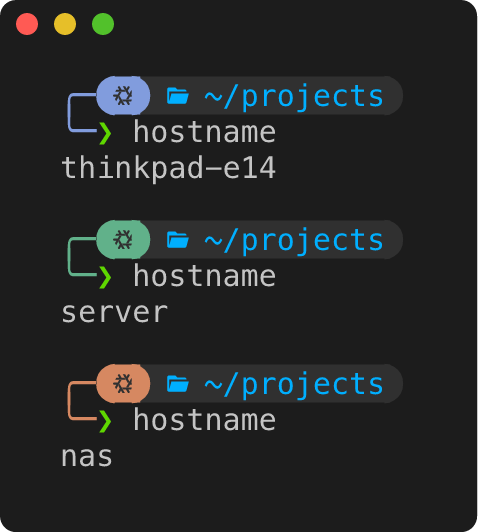

# hostcolor

Print a stable color derived from a string, the hostname by default.



The seed's FNV-1a hash picks a hue in [Okhsl], which keeps every hue equally
vivid as perceived. Saturation and lightness are shared, so all colors match
in tone.

## Usage

```bash
$ hostcolor
#819CDD
$ hostcolor server
#61B18A
$ hostcolor -f fg            # ANSI escape setting the foreground
$ hostcolor -f bg -s 0.8     # background, more saturated
```

| Option               | Default  | Description                      |
|----------------------|----------|----------------------------------|
| `[SEED]`             | hostname | string to derive the color from  |
| `-f`, `--format`     | `hex`    | `hex`, `fg` or `bg`              |
| `-s`, `--saturation` | `0.6`    | Okhsl saturation, 0 to 1         |
| `-l`, `--lightness`  | `0.65`   | Okhsl lightness, 0 to 1          |

## Starship

```toml
format = "${custom.accent}╭─ $all"

[custom.accent]
when = true
format = "$output"

command = "hostcolor -f fg"
```

[Okhsl]: https://bottosson.github.io/posts/colorpicker/
